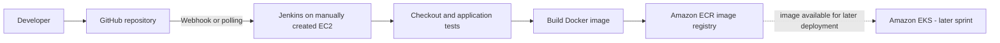
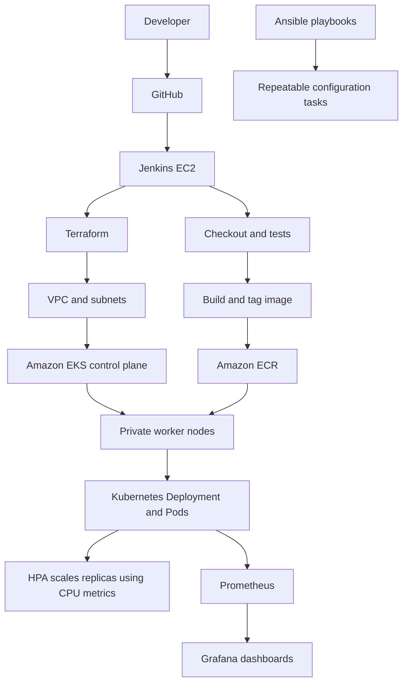

# End-to-End DevOps Pipeline for a Web Application

A capstone project demonstrating CI/CD, Infrastructure as Code, containerization, Kubernetes deployment, configuration management, autoscaling, and monitoring.

**Repository:** https://github.com/mouleeswarand/devops-capstone-project  
**AWS region:** `us-east-1`  
**Kubernetes cluster:** `devops-capstone-eks`  
**Application deployment:** `devops-capstone-app`  
**Terraform working directory (WSL):** `devops-capstone-project/terraform`  
**Kubernetes manifests (WSL):** `~devops-capstone-project/k8s`

## 1. Project goals

- Build and test application code with Jenkins.
- Build a Docker image and publish it to Amazon ECR.
- Deploy the image to Amazon EKS and verify rollout health.
- Use Terraform for repeatable AWS infrastructure.
- Use Ansible for repeatable configuration tasks.
- Use Kubernetes resource requests/limits and Horizontal Pod Autoscaler (HPA).
- Collect metrics with Prometheus and visualize them in Grafana.
- Capture command output and screenshots as evidence for each sprint.

## 2. Sprint plan

| Sprint | Delivery | Automation level |
|---|---|---|
| Sprint 1 | Manually create/configure Node Application, Jenkins EC2, install Jenkins and required tools, connect source control, create the initial pipeline | Manual foundation |
| Sprint 2 | Complete continuous integration and image delivery: checkout, tests, Docker build, ECR login/push; confirm the pipeline runs successfully | CI established; Jenkins EC2 remains manually provisioned |
| Sprint 3 | Terraform-managed AWS foundation and EKS resources; validate infrastructure state and cluster access | Infrastructure as Code |
| Sprint 4 | Kubernetes deployment and CI/CD release to EKS; verify pods, services, rollout and HPA | Automated deployment |
| Sprint 5 | Ansible configuration/provisioning tasks and repeatable operational steps | Configuration management |
| Sprint 6 | Prometheus/Grafana monitoring, metric queries, load/HPA validation, final evidence and documentation | Monitoring and final validation |

The sprint names above describe the project flow. Update them if the submitted course rubric uses different official titles.

## 3. Architecture

### Sprints 1–2: manual Jenkins foundation and CI



**Flow:** A code change reaches GitHub. Jenkins checks out the code, runs tests, builds the container image and pushes a versioned image to ECR. In these sprints, Jenkins EC2 provisioning is manual; the CI pipeline is configured and validated through Jenkins.

### Sprints 3–6: infrastructure, deployment, configuration and monitoring



**Design note:** Terraform creates/updates infrastructure; Jenkins orchestrates build and release; ECR stores container images; EKS runs the workload; Ansible handles the configuration tasks defined in the repository; Prometheus collects metrics and Grafana displays them. Keep the actual deployment and monitoring paths consistent with the files in the repository.

## 4. Prerequisites

- AWS account permissions for the Terraform resources used by this project.
- AWS CLI configured for the intended account and `us-east-1`.
- Terraform, `kubectl`, and (where applicable) Ansible installed on the machine running the commands.
- Docker available to the Jenkins build environment.
- Jenkins credentials for GitHub and AWS/ECR configured through Jenkins Credentials, not hard-coded in a Jenkinsfile.
- Access to the EKS cluster for `kubectl`.
- The project repository cloned locally.

Check the active AWS identity and tool versions before making changes:

```bash
aws sts get-caller-identity
# Confirms which AWS account and IAM identity the CLI is using.

aws configure get region
# Shows the default AWS CLI region, if configured.

terraform version
# Confirms Terraform is installed.

kubectl version --client
# Confirms the kubectl client is installed.

git status --short
# Shows local changes before you edit or commit project files.

docker --version
# use docker desktop

```

## 5. Sprint 1 — create Jenkins EC2 manually

1. In AWS Console, create the Jenkins EC2 instance in the chosen VPC/subnet.
2. Attach an IAM role with only the permissions required for ECR and EKS deployment.
3. Configure the security group to allow SSH only from your trusted IP and Jenkins UI access only from a trusted IP/VPN. Avoid exposing port `8080` to the entire internet.
4. Connect over SSH and install Java, Jenkins, Git, Docker, AWS CLI, `kubectl`, and any other tools required by the Jenkinsfile.
5. Start Jenkins, open the UI, retrieve the initial administrator password, and complete setup.
6. Add GitHub and AWS access through Jenkins Credentials.
7. Create the pipeline job and connect it to the GitHub repository.


### Create the local project directory
```bash
cd /home/mouli/project/devops-capstone-project
mkdir -p ~/devops-capstone-project

#Create the initial folders
mkdir application
mkdir terraform
mkdir ansible
mkdir k8s
mkdir jenkins

### Create Git repository
git init

Create .gitignore

cat > .gitignore <<'EOF'
.terraform/
*.tfstate
*.tfstate.*
*.tfvars
!example.tfvars
.terraform.lock.hcl
.env
.env.*
*.pem
*.key
credentials
EOF

git status
git add .
git commit -m "Initial capstone project structure"
git push origin main
```

### Create the application
bash```
cd application
npm init -y
npm install express

cat > server.js <<'EOF'
const express = require("express");

const app = express();

const PORT = process.env.PORT || 3000;

app.get("/", (req, res) => {
    res.json({
        message: "Hello from DevOps Capstone!",
        status: "success",
        version: "1.0.0"
    });
});

app.get("/health", (req, res) => {
    res.status(200).json({
        status: "UP"
    });
});

app.listen(PORT, "0.0.0.0", () => {
    console.log(`Application running on port ${PORT}`);
});
EOF
```

### Test the application without Docker first
```bash
node server.js
```

### Bash output
 

### curl http://localhost:3000
 /br

### curl http://localhost:3000/health


### Create the Dockerfile
```bash
cat > Dockerfile <<'EOF'
FROM node:22-alpine

WORKDIR /app

COPY package*.json ./

RUN npm ci --omit=dev

COPY . .

EXPOSE 3000

CMD ["node", "server.js"]
EOF

### Build the Docker image
```bash
docker info

docker build -t devops-capstone-app:1.0 .

docker run -d --name devops-capstone-app -p 3000:3000 devops-capstone-app:1.0

```

### Test the application with Docker 
```bash
docker ps
docker logs devops-capstone-app
```

### Bash output


### Check Docker logs
 

### curl http://localhost:3000
 /br

### curl http://localhost:3000/health


### GIT Commit the application
```bash
git status
git add ./application
git commit -m "Add Dockerized Node.js application"
git push oringin main
git status
```

### configure ECR : Push Docker Image to AWS ECR

###  Check the AWS account
```bash
aws sts get-caller-identity

aws ecr create-repository \
    --repository-name devops-capstone-app \
    --region us-east-1

aws ecr describe-repositories \
    --repository-names devops-capstone-app \
    --region us-east-1
```

### Create an ECR URI variable
```bash
export AWS_ACCOUNT_ID=$(aws sts get-caller-identity --region us-east-1 --query Account --output text)
export AWS_REGION=us-east-1
export ECR_URI="$AWS_ACCOUNT_ID.dkr.ecr.us-east-1.amazonaws.com/devops-capstone-app"
echo $ECR_URI
```

### Authenticate Docker with ECR
```bash
aws ecr get-login-password --region $AWS_REGION | \
docker login --username AWS --password-stdin "$AWS_ACCOUNT_ID.dkr.ecr.$AWS_REGION.amazonaws.com"
```


### Check the Docker image
```bash
docker images

## Tag the Docker image
docker tag devops-capstone-app:1.0 "$ECR_URI:1.0"
docker push "$ECR_URI:1.0"
```


### Verify from AWS CLI
```bash
aws ecr describe-images \
    --repository-name devops-capstone-app \
    --region $AWS_REGION
```


### Test pulling from ECR
```bash
docker rmi "$ECR_URI:1.0"
docker pull "$ECR_URI:1.0"
docker images
```


### Run the container
```bash
docker run -d \
    --name ecr-test \
    -p 3000:3000 \
    "$ECR_URI:1.0"

```


### Bash output


### Check Docker logs
 

### curl http://localhost:3000
 /br

### curl http://localhost:3000/health


### Clean up the test container
```bash
docker rm -f $(docker ps -q)
```

### Create the Jenkins EC2 instance

We are doing this manually once Jenkins working fine we will create it by using Terraform

Go to:

EC2 → Instances → Launch instance

| Name | jenkins-vm |
| AMI | ubuntu/images/hvm-ssd-gp3/ubuntu-noble-24.04-amd64-server-20260610 |
| Instance type | m7i-flex.large |
| Security Group| devops-capstone-jenkins-role (port 22, 8080(jenkins) - allowed) |

***Connect using SSH***
```bash
### Opens a secure shell on the Jenkins EC2 instance.
ssh -i capstone.pem ubuntu@44.199.253.141

### Verify the server
whoami
hostname
uname -a
free -h
df -h

### install dependencies

sudo apt update && sudo apt upgrade -y

### Install Java
sudo apt install fontconfig openjdk-21-jre -y

### Install Jenkins
sudo wget -O /etc/apt/keyrings/jenkins-keyring.asc \
  https://pkg.jenkins.io/debian-stable/jenkins.io-2026.key
echo "deb [signed-by=/etc/apt/keyrings/jenkins-keyring.asc] https://pkg.jenkins.io/debian-stable binary/" | \
  sudo tee /etc/apt/sources.list.d/jenkins.list > /dev/null
sudo apt install jenkins -y

### Start Jenkins
sudo systemctl enable jenkins
sudo systemctl start jenkins
sudo ss -lntp | grep 8080

### Get Jenkins initial password
sudo cat /var/lib/jenkins/secrets/initialAdminPassword

### Open Jenkins - Web browser (Install Jenkins plugins and Create Jenkins administrator)
http://44.199.253.141:8080/


### Install Docker on Jenkins
sudo apt install docker.io -y
sudo systemctl enable docker
sudo systemctl start docker

### Give Jenkins permission to use Docker
id jenkins
sudo usermod -aG docker jenkins
sudo systemctl restart jenkins
groups jenkins

### Test Docker as Jenkins
sudo -u jenkins docker ps

### Install AWS CLI
aws --version
sudo apt install unzip curl -y
curl "https://awscli.amazonaws.com/awscli-exe-linux-x86_64.zip" -o "awscliv2.zip"
unzip awscliv2.zip
sudo ./aws/install
aws --version


### Install Git
sudo apt install git -y
git --version


###check all the dependencies have installed
java -version
docker --version
git --version
aws --version
sudo systemctl status jenkins
sudo -u jenkins docker ps


### Create an IAM Role for Jenkins


### Attach the role to Jenkins EC2


### Verify the IAM role from Jenkins
aws sts get-caller-identity


### Verify ECR access from Jenkins
aws ecr describe-repositories \
    --repository-names devops-capstone-app \
    --region us-east-1

### Create the Jenkins pipeline file
cd /home/mouli/project/devops-capstone-project/jenkins
nano Jenkinsfile

pipeline {

    agent any

    environment {
        AWS_REGION = 'us-east-1'
        ECR_REPOSITORY = 'devops-capstone-app'
        IMAGE_TAG = "${BUILD_NUMBER}"
    }

    stages {

        stage('Checkout') {
            steps {
                checkout scm
            }
        }

        stage('Test') {
            steps {
                dir('application') {
                    sh '''
                        npm ci
                        node --check server.js
                    '''
                }
            }
        }

        stage('Build Docker Image') {
            steps {
                dir('application') {
                    sh '''
                        docker build \
                        -t ${ECR_REPOSITORY}:${IMAGE_TAG} \
                        .
                    '''
                }
            }
        }

        stage('ECR Login') {
            steps {
                sh '''
                    AWS_ACCOUNT_ID=$(aws sts get-caller-identity \
                        --query Account \
                        --output text)

                    aws ecr get-login-password \
                        --region ${AWS_REGION} | \
                    docker login \
                        --username AWS \
                        --password-stdin \
                        ${AWS_ACCOUNT_ID}.dkr.ecr.${AWS_REGION}.amazonaws.com
                '''
            }
        }

        stage('Tag Docker Image') {
            steps {
                sh '''
                    AWS_ACCOUNT_ID=$(aws sts get-caller-identity \
                        --query Account \
                        --output text)

                    docker tag \
                        ${ECR_REPOSITORY}:${IMAGE_TAG} \
                        ${AWS_ACCOUNT_ID}.dkr.ecr.${AWS_REGION}.amazonaws.com/${ECR_REPOSITORY}:${IMAGE_TAG}
                '''
            }
        }

        stage('Push to ECR') {
            steps {
                sh '''
                    AWS_ACCOUNT_ID=$(aws sts get-caller-identity \
                        --query Account \
                        --output text)

                    docker push \
                        ${AWS_ACCOUNT_ID}.dkr.ecr.${AWS_REGION}.amazonaws.com/${ECR_REPOSITORY}:${IMAGE_TAG}
                '''
            }
        }
    }

    post {
        success {
            echo 'CI pipeline completed successfully!'
        }

        failure {
            echo 'CI pipeline failed. Check the Jenkins console output.'
        }
    }
}


### Commit the Jenkinsfile
git add ./jenkins/Jenkinsfile
git commit -m "Add Jenkins CI pipeline"
git push origin main

### Create the Jenkins Pipeline


### configure  → Jenkins Automatic Trigger


### Jenkins Pipeline - Output


# CI is successfully implement manually, We have to do this using Terraform


**Evidence screenshots**
- **S1-01:** EC2 instance details showing instance state, instance type and region. Hide account-sensitive details if sharing publicly.
- **S1-02:** EC2 security-group inbound rules, showing restricted SSH and Jenkins UI access.
- **S1-03:** Jenkins dashboard after initial setup.
- **S1-04:** Jenkins Credentials page showing credential *names/IDs only*; never reveal secret values.
- **S1-05:** Jenkins pipeline job configuration with repository URL and branch.

## 6. Sprint 2 — continuous integration and image publishing

1. Confirm the Jenkins job checks out the correct branch.
2. Run the application tests.
3. Build the Docker image and tag it with a build number or commit identifier.
4. Authenticate to Amazon ECR using a short-lived token.
5. Push the image to ECR.
6. Run the job again after a small commit and confirm a new build/image is produced.

Typical validation commands on a machine with AWS CLI and Docker configured:

```bash
aws sts get-caller-identity
# Confirms the AWS identity used for ECR operations.

aws ecr describe-repositories --region us-east-1
# Lists ECR repositories visible to this identity.

aws ecr list-images --repository-name devops-capstone-app --region us-east-1
# Lists image tags/digests in the application repository.
```

The pipeline should use the repository's actual test and build commands. Do not copy a guessed `npm test` or Docker build command over the working Jenkinsfile without checking `package.json`, the Dockerfile and Jenkinsfile first.

**Evidence screenshots**
- **S2-01:** Jenkins build stage view showing checkout and test stages successful.
- **S2-02:** Jenkins console output showing tests passed (hide tokens and credentials).
- **S2-03:** Docker build and ECR push stages successful.
- **S2-04:** ECR repository showing the newly pushed image tag.
- **S2-05:** A second successful build after a new Git commit, proving CI is repeatable.


