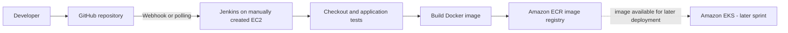
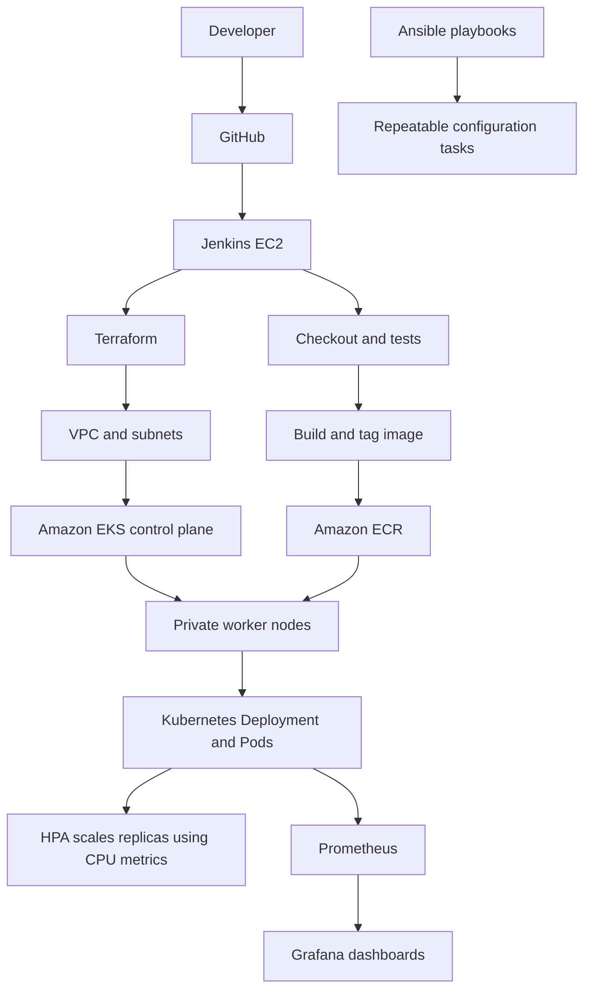

# End-to-End DevOps Pipeline for a Web Application

A capstone project demonstrating CI/CD, Infrastructure as Code, containerization, Kubernetes deployment, configuration management, autoscaling, and monitoring.

**Repository:** https://github.com/mouleeswarand/devops-capstone-project  
**AWS region:** `us-east-1`  
**Kubernetes cluster:** `devops-capstone-eks`  
**Application deployment:** `devops-capstone-app`  
**Terraform working directory (WSL):** `devops-capstone-project/terraform`  
**Kubernetes manifests (WSL):** `~devops-capstone-project/k8s`

## 1. Project goals

- Build and test application code with Jenkins.
- Build a Docker image and publish it to Amazon ECR.
- Deploy the image to Amazon EKS and verify rollout health.
- Use Terraform for repeatable AWS infrastructure.
- Use Ansible for repeatable configuration tasks.
- Use Kubernetes resource requests/limits and Horizontal Pod Autoscaler (HPA).
- Collect metrics with Prometheus and visualize them in Grafana.
- Capture command output and screenshots as evidence for each sprint.

## 2. Sprint plan

| Sprint | Delivery | Automation level |
|---|---|---|
| Sprint 1 | Manually create/configure Node Application, Jenkins EC2, install Jenkins and required tools, connect source control, create the initial pipeline | Manual foundation |
| Sprint 2 | Complete continuous integration and image delivery: checkout, tests, Docker build, ECR login/push; confirm the pipeline runs successfully | CI established; Jenkins EC2 remains manually provisioned |
| Sprint 3 | Terraform-managed AWS foundation and EKS resources; validate infrastructure state and cluster access | Infrastructure as Code |
| Sprint 4 | Kubernetes deployment and CI/CD release to EKS; verify pods, services, rollout and HPA | Automated deployment |
| Sprint 5 | Ansible configuration/provisioning tasks and repeatable operational steps | Configuration management |
| Sprint 6 | Prometheus/Grafana monitoring, metric queries, load/HPA validation, final evidence and documentation | Monitoring and final validation |

The sprint names above describe the project flow. Update them if the submitted course rubric uses different official titles.

## 3. Architecture

### Sprints 1–2: manual Jenkins foundation and CI



**Flow:** A code change reaches GitHub. Jenkins checks out the code, runs tests, builds the container image and pushes a versioned image to ECR. In these sprints, Jenkins EC2 provisioning is manual; the CI pipeline is configured and validated through Jenkins.

### Sprints 3–6: infrastructure, deployment, configuration and monitoring



**Design note:** Terraform creates/updates infrastructure; Jenkins orchestrates build and release; ECR stores container images; EKS runs the workload; Ansible handles the configuration tasks defined in the repository; Prometheus collects metrics and Grafana displays them. Keep the actual deployment and monitoring paths consistent with the files in the repository.

## 4. Prerequisites

- AWS account permissions for the Terraform resources used by this project.
- AWS CLI configured for the intended account and `us-east-1`.
- Terraform, `kubectl`, and (where applicable) Ansible installed on the machine running the commands.
- Docker available to the Jenkins build environment.
- Jenkins credentials for GitHub and AWS/ECR configured through Jenkins Credentials, not hard-coded in a Jenkinsfile.
- Access to the EKS cluster for `kubectl`.
- The project repository cloned locally.

Check the active AWS identity and tool versions before making changes:

```bash
aws sts get-caller-identity
# Confirms which AWS account and IAM identity the CLI is using.

aws configure get region
# Shows the default AWS CLI region, if configured.

terraform version
# Confirms Terraform is installed.

kubectl version --client
# Confirms the kubectl client is installed.

git status --short
# Shows local changes before you edit or commit project files.

docker --version
# use docker desktop

```

## 5. Sprint 1

### create Jenkins EC2 manually

1. In AWS Console, create the Jenkins EC2 instance in the chosen VPC/subnet.
2. Attach an IAM role with only the permissions required for ECR and EKS deployment.
3. Configure the security group to allow SSH only from your trusted IP and Jenkins UI access only from a trusted IP/VPN. Avoid exposing port `8080` to the entire internet.
4. Connect over SSH and install Java, Jenkins, Git, Docker, AWS CLI, `kubectl`, and any other tools required by the Jenkinsfile.
5. Start Jenkins, open the UI, retrieve the initial administrator password, and complete setup.
6. Add GitHub and AWS access through Jenkins Credentials.
7. Create the pipeline job and connect it to the GitHub repository.


### Create the local project directory
```bash
cd /home/mouli/project/devops-capstone-project
mkdir -p ~/devops-capstone-project

#Create the initial folders
mkdir application
mkdir terraform
mkdir ansible
mkdir k8s
mkdir jenkins

### Create Git repository
git init

Create .gitignore

cat > .gitignore <<'EOF'
.terraform/
*.tfstate
*.tfstate.*
*.tfvars
!example.tfvars
.terraform.lock.hcl
.env
.env.*
*.pem
*.key
credentials
EOF

git status
git add .
git commit -m "Initial capstone project structure"
git push origin main
```

### Create the application
bash```
cd application
npm init -y
npm install express

cat > server.js <<'EOF'
const express = require("express");

const app = express();

const PORT = process.env.PORT || 3000;

app.get("/", (req, res) => {
    res.json({
        message: "Hello from DevOps Capstone!",
        status: "success",
        version: "1.0.0"
    });
});

app.get("/health", (req, res) => {
    res.status(200).json({
        status: "UP"
    });
});

app.listen(PORT, "0.0.0.0", () => {
    console.log(`Application running on port ${PORT}`);
});
EOF
```

### Test the application without Docker first
```bash
node server.js
```

### Bash output
 

### curl http://localhost:3000
 /br

### curl http://localhost:3000/health


### Create the Dockerfile
```bash
cat > Dockerfile <<'EOF'
FROM node:22-alpine

WORKDIR /app

COPY package*.json ./

RUN npm ci --omit=dev

COPY . .

EXPOSE 3000

CMD ["node", "server.js"]
EOF

### Build the Docker image
```bash
docker info

docker build -t devops-capstone-app:1.0 .

docker run -d --name devops-capstone-app -p 3000:3000 devops-capstone-app:1.0

```

### Test the application with Docker 
```bash
docker ps
docker logs devops-capstone-app
```

### Bash output


### Check Docker logs
 

### curl http://localhost:3000
 /br

### curl http://localhost:3000/health


### GIT Commit the application
```bash
git status
git add ./application
git commit -m "Add Dockerized Node.js application"
git push oringin main
git status
```

### configure ECR : Push Docker Image to AWS ECR

###  Check the AWS account
```bash
aws sts get-caller-identity

aws ecr create-repository \
    --repository-name devops-capstone-app \
    --region us-east-1

aws ecr describe-repositories \
    --repository-names devops-capstone-app \
    --region us-east-1
```

### Create an ECR URI variable
```bash
export AWS_ACCOUNT_ID=$(aws sts get-caller-identity --region us-east-1 --query Account --output text)
export AWS_REGION=us-east-1
export ECR_URI="$AWS_ACCOUNT_ID.dkr.ecr.us-east-1.amazonaws.com/devops-capstone-app"
echo $ECR_URI
```

### Authenticate Docker with ECR
```bash
aws ecr get-login-password --region $AWS_REGION | \
docker login --username AWS --password-stdin "$AWS_ACCOUNT_ID.dkr.ecr.$AWS_REGION.amazonaws.com"
```


### Check the Docker image
```bash
docker images

## Tag the Docker image
docker tag devops-capstone-app:1.0 "$ECR_URI:1.0"
docker push "$ECR_URI:1.0"
```


### Verify from AWS CLI
```bash
aws ecr describe-images \
    --repository-name devops-capstone-app \
    --region $AWS_REGION
```


### Test pulling from ECR
```bash
docker rmi "$ECR_URI:1.0"
docker pull "$ECR_URI:1.0"
docker images
```


### Run the container
```bash
docker run -d \
    --name ecr-test \
    -p 3000:3000 \
    "$ECR_URI:1.0"

```


### Bash output


### Check Docker logs
 

### curl http://localhost:3000
 /br

### curl http://localhost:3000/health


### Clean up the test container
```bash
docker rm -f $(docker ps -q)
```

### Create the Jenkins EC2 instance

We are doing this manually once Jenkins working fine we will create it by using Terraform

Go to:

EC2 → Instances → Launch instance
Name:  jenkins-vm 
AMI: ubuntu/images/hvm-ssd-gp3/ubuntu-noble-24.04-amd64-server-20260610
Instance type: m7i-flex.large
Security Group: devops-capstone-jenkins-role (port 22, 8080(jenkins) - allowed)

***Connect using SSH***
```bash
### Opens a secure shell on the Jenkins EC2 instance.
ssh -i capstone.pem ubuntu@44.199.253.141

### Verify the server
whoami
hostname
uname -a
free -h
df -h

### install dependencies
sudo apt update && sudo apt upgrade -y

### Install Java
sudo apt install fontconfig openjdk-21-jre -y

### Install Jenkins
sudo wget -O /etc/apt/keyrings/jenkins-keyring.asc \
  https://pkg.jenkins.io/debian-stable/jenkins.io-2026.key
echo "deb [signed-by=/etc/apt/keyrings/jenkins-keyring.asc] https://pkg.jenkins.io/debian-stable binary/" | \
  sudo tee /etc/apt/sources.list.d/jenkins.list > /dev/null
sudo apt install jenkins -y

### Start Jenkins
sudo systemctl enable jenkins
sudo systemctl start jenkins
sudo ss -lntp | grep 8080

### Get Jenkins initial password
sudo cat /var/lib/jenkins/secrets/initialAdminPassword

### Open Jenkins - Web browser (Install Jenkins plugins and Create Jenkins administrator)
http://44.199.253.141:8080/


### Install Docker on Jenkins
sudo apt install docker.io -y
sudo systemctl enable docker
sudo systemctl start docker

### Give Jenkins permission to use Docker
id jenkins
sudo usermod -aG docker jenkins
sudo systemctl restart jenkins
groups jenkins

### Test Docker as Jenkins
sudo -u jenkins docker ps

### Install AWS CLI
aws --version
sudo apt install unzip curl -y
curl "https://awscli.amazonaws.com/awscli-exe-linux-x86_64.zip" -o "awscliv2.zip"
unzip awscliv2.zip
sudo ./aws/install
aws --version


### Install Git
sudo apt install git -y
git --version


###check all the dependencies have installed
java -version
docker --version
git --version
aws --version
sudo systemctl status jenkins
sudo -u jenkins docker ps


### Create an IAM Role for Jenkins


### Attach the role to Jenkins EC2


### Verify the IAM role from Jenkins
aws sts get-caller-identity


### Verify ECR access from Jenkins
aws ecr describe-repositories \
    --repository-names devops-capstone-app \
    --region us-east-1

### Create the Jenkins pipeline file
cd /home/mouli/project/devops-capstone-project/jenkins
nano Jenkinsfile

pipeline {

    agent any

    environment {
        AWS_REGION = 'us-east-1'
        ECR_REPOSITORY = 'devops-capstone-app'
        IMAGE_TAG = "${BUILD_NUMBER}"
    }

    stages {

        stage('Checkout') {
            steps {
                checkout scm
            }
        }

        stage('Test') {
            steps {
                dir('application') {
                    sh '''
                        npm ci
                        node --check server.js
                    '''
                }
            }
        }

        stage('Build Docker Image') {
            steps {
                dir('application') {
                    sh '''
                        docker build \
                        -t ${ECR_REPOSITORY}:${IMAGE_TAG} \
                        .
                    '''
                }
            }
        }

        stage('ECR Login') {
            steps {
                sh '''
                    AWS_ACCOUNT_ID=$(aws sts get-caller-identity \
                        --query Account \
                        --output text)

                    aws ecr get-login-password \
                        --region ${AWS_REGION} | \
                    docker login \
                        --username AWS \
                        --password-stdin \
                        ${AWS_ACCOUNT_ID}.dkr.ecr.${AWS_REGION}.amazonaws.com
                '''
            }
        }

        stage('Tag Docker Image') {
            steps {
                sh '''
                    AWS_ACCOUNT_ID=$(aws sts get-caller-identity \
                        --query Account \
                        --output text)

                    docker tag \
                        ${ECR_REPOSITORY}:${IMAGE_TAG} \
                        ${AWS_ACCOUNT_ID}.dkr.ecr.${AWS_REGION}.amazonaws.com/${ECR_REPOSITORY}:${IMAGE_TAG}
                '''
            }
        }

        stage('Push to ECR') {
            steps {
                sh '''
                    AWS_ACCOUNT_ID=$(aws sts get-caller-identity \
                        --query Account \
                        --output text)

                    docker push \
                        ${AWS_ACCOUNT_ID}.dkr.ecr.${AWS_REGION}.amazonaws.com/${ECR_REPOSITORY}:${IMAGE_TAG}
                '''
            }
        }

        stage('Deploy to EKS') {
            steps {
                sh '''
                    AWS_ACCOUNT_ID=$(aws sts get-caller-identity \
                        --query Account \
                        --output text)

                    IMAGE_URI=${AWS_ACCOUNT_ID}.dkr.ecr.${AWS_REGION}.amazonaws.com/${ECR_REPOSITORY}:${IMAGE_TAG}

                    kubectl set image \
                        deployment/devops-capstone-app \
                        web=${IMAGE_URI} \
                        --namespace default

                    kubectl rollout status \
                        deployment/devops-capstone-app \
                        --namespace default \
                        --timeout=180s
                '''
            }
        }
    }

    post {
        success {
            echo 'CI pipeline completed successfully!'
        }

        failure {
            echo 'CI pipeline failed. Check the Jenkins console output.'
        }
    }


}

### Commit the Jenkinsfile
git add ./jenkins/Jenkinsfile
git commit -m "Add Jenkins CI pipeline"
git push origin main

### Create the Jenkins Pipeline


### configure  → Jenkins Automatic Trigger


### Jenkins Pipeline - Output

```

# CI is successfully implement manually, We have to do this using Terraform

## 6. Sprint 2 — Terraform infrastructure

Run these commands from the Terraform directory:

```bash
cd ~/project/devops-capstone-project/terraform
# Moves to the folder containing Terraform configuration.

terraform init
# Initializes the providers and remote state backend.

terraform fmt -check -recursive
# Checks formatting without changing files.

terraform validate
# Checks Terraform configuration syntax and internal consistency.

terraform plan
# Shows the proposed infrastructure changes without applying them.

terraform workspace show
# Identify the active Terraform workspace.

terraform state list
# List resources already recorded in the remote Terraform state.

terraform destory
# this will destroy the complete resources created using Terraform
```

Review the plan carefully before applying it. Only apply when the resources and costs are understood:

```bash
terraform apply
# Creates or updates resources after interactive approval.
```

For the existing remote backend, the project has used an S3 state bucket with encryption, versioning, public-access blocking, and S3 lockfile support. Do not delete the state bucket or run `terraform destroy` as a routine validation step.


### Create the Terraform files
cd ~/devops-capstone-project/terraform

touch providers.tf variables.tf main.tf outputs.tf backend.tf versions.tf jenkins.tf iam.tf network.tf bootstrap.tf


### Configure the S3 backend: /home/mouli/project/devops-capstone-project/terraform/backend.tf
Configure the AWS provider: /home/mouli/project/devops-capstone-project/terraform/providers.tf
Configure the AWS version: /home/mouli/project/devops-capstone-project/terraform/versions.tf


terraform fmt
terraform validate
terraform plan
terraform apply

aws s3api get-bucket-versioning \
  --bucket devops-capstone-jenkins-tfstate-625228299204-us-east-1


terraform state list
    data.aws_caller_identity.current
    aws_s3_bucket.jenkins_tfstate
    aws_s3_bucket_public_access_block.jenkins_tfstate
    aws_s3_bucket_server_side_encryption_configuration.jenkins_tfstate
    aws_s3_bucket_versioning.jenkins_tfstate

Configure variables.tf: /home/mouli/project/devops-capstone-project/variables.tf
Configure network.tf: /home/mouli/project/devops-capstone-project/network.tf
Add my IP to terraform.tfvars: /home/mouli/project/devops-capstone-project/terraform.tfvars
curl -4 https://checkip.amazonaws.com # this will provide the current ipv4 address

Create the IAM role for Jenkins: /home/mouli/project/devops-capstone-project/iam.tf
Add the Jenkins EC2 configuration: /home/mouli/project/devops-capstone-project/jenkins.tf
Add outputs: /home/mouli/project/devops-capstone-project/outputs.tf


terraform fmt
terraform validate
terraform plan

terraform plan -out=jenkins-plan
terraform show jenkins-plan
terraform apply jenkins-plan


### Access Jenkins URL (http://184.195.178.174:8080/)


### Configure Jenkins tools through SSM

aws ssm start-session \
 --region us-east-1 \
 --target i-0269f659aaec1cfc1

sudo apt-get update
sudo apt-get install -y git docker.io unzip curl
sudo systemctl enable --now docker
sudo usermod -aG docker jenkins
sudo systemctl restart jenkins
git --version
docker --version

### Verify Git and Docker
git --version
docker --version
sudo systemctl is-active docker
sudo -u jenkins -H docker ps

### Install Terraform
sudo apt-get update && sudo apt-get install -y wget unzip
cd /tmp

wget https://releases.hashicorp.com/terraform/1.16.4/terraform_1.16.4_linux_amd64.zip
unzip -o terraform_1.16.4_linux_amd64.zip

sudo install terraform /usr/local/bin/terraform

terraform version

### Create the Terraform Jenkins pipeline
cd /home/mouli/project/devops-capstone-project
nano jenkins/Terraform.Jenkinsfile

### Configure the Jenkins Credentials


### Configure the Jenkins job from GitHub


### Jenkins output


### create the EKS infrastructure


### Describe Cluster
aws eks describe-cluster \
  --name devops-capstone-eks \
  --region us-east-1 \
  --query 'cluster.{Name:name,Status:status,Version:version,Endpoint:endpoint}' \
  --output table


### Node Group
aws eks describe-nodegroup \
  --cluster-name devops-capstone-eks \
  --nodegroup-name devops-capstone-workers \
  --region us-east-1 \
  --query 'nodegroup.{Status:status,DesiredSize:scalingConfig.desiredSize,InstanceTypes:instanceTypes}' \
  --output table


### Configure kubectl
aws eks update-kubeconfig \
  --region us-east-1 \
  --name devops-capstone-eks

### verify the connection

kubectl config current-context

kubectl get nodes -o wide


kubectl get pods -A


### Deploy the application
kubectl apply -f k8s/deployment.yaml
kubectl apply -f k8s/service.yaml

### verify
kubectl rollout status deployment/devops-capstone-app \
  --namespace default --timeout=180s

kubectl get deployments,pods,services -n default


### Configure autoscaling (HPA

### Metics server installation
aws eks describe-addon-versions \
  --addon-name metrics-server \
  --kubernetes-version 1.35 \
  --region us-east-1 \
  --query 'addons[0].addonVersions[*].addonVersion' \
  --output table

aws eks create-addon \
  --cluster-name devops-capstone-eks \
  --addon-name metrics-server \
  --addon-version v0.9.0-eksbuild.13 \
  --region us-east-1

aws eks describe-addon \
  --cluster-name devops-capstone-eks \
  --addon-name metrics-server \
  --region us-east-1 \
  --query 'addon.status' \
  --output text

### verify Metics-server
kubectl get pods -n kube-system
kubectl top nodes


### Create the HPA
kubectl autoscale deployment devops-capstone-app \
  --namespace default \
  --cpu-percent=70 \
  --min=2 \
  --max=4

kubectl get hpa devops-capstone-app


### Ansible deployment

ansible-playbook -i 'local,' \
  -c local \
  ansible/verify-deployment.yml


## 7. Sprint 3: Jenkins CI/CD integration with AWS EKS

### Add the Jenkins IAM role
kubectl edit configmap aws-auth -n kube-system

###Add the following
    - rolearn: arn:aws:iam::625228299204:role/devops-capstone-jenkins-ec2-role
      username: jenkins
      groups:
        - jenkins-deployer
        
kubectl get configmap aws-auth -n kube-system \
  -o jsonpath='{.data.mapRoles}'

### Apply Jenkins deployment permissions
cd ~/project/devops-capstone-project

kubectl apply -f k8s/rbac/jenkins-deployer-rbac.yaml
kubectl get role jenkins-deployer -n default
kubectl get rolebinding jenkins-deployer -n default


### Jenkins-to-EKS access (Run this in your current SSM session)

### Install AWS CLI 
sudo apt-get update
sudo apt-get install -y unzip curl

cd /tmp
curl -fsSLo awscliv2.zip \
  "https://awscli.amazonaws.com/awscli-exe-linux-x86_64.zip"

unzip -oq awscliv2.zip
sudo ./aws/install

aws --version

### Install kubectl

KUBECTL_VERSION="$(curl -fsSL \
  https://dl.k8s.io/release/stable.txt)"

curl -fsSLo /tmp/kubectl \
  "https://dl.k8s.io/release/${KUBECTL_VERSION}/bin/linux/amd64/kubectl"

sudo install -o root -g root -m 0755 /tmp/kubectl /usr/local/bin/kubectl

kubectl version --client

### Install Node.js 22 and npm
curl -fsSL https://deb.nodesource.com/setup_22.x | sudo -E bash -
sudo apt-get install -y nodejs

### Versio check
aws --version
kubectl version --client
node --version
npm --version
docker --version

### Test the permissions the pipeline actually needs
sudo -u jenkins -H bash -lc '
echo "=== Deployment access ==="
kubectl get deployment devops-capstone-app -n default

echo "=== Pod access ==="
kubectl get pods -n default

echo "=== HPA access ==="
kubectl get hpa devops-capstone-app -n default

echo "=== Deployment update permission ==="
kubectl auth can-i patch deployments -n default

echo "=== Rollout status permission ==="
kubectl auth can-i get deployments -n default

echo "=== ECR repository access ==="
aws ecr describe-repositories \
  --region us-east-1 \
  --repository-names devops-capstone-app \
  --query "repositories[0].repositoryUri" \
  --output text
### Verify the rollout
kubectl rollout status deployment/devops-capstone-app --timeout=180s

### Verify autoscaling
kubectl get hpa devops-capstone-app

### Test the application health endpoint
kubectl port-forward service/devops-capstone-app 8080:80

curl -i http://localhost:8080/health


#### Sprint 3 & 4 is now fully verified and complete.
- Deployment rollout: Successful
- Application pods: 2/2 running
- Health endpoint: HTTP 200 OK
- HPA: Working — minimum 2, maximum 4 replicas
- CPU utilization: 1% against a 70% target
- CI/CD pipeline: Jenkins build successful
- Ansible: Deployment verification playbook passed earlier

## 8. Sprint 5: Monitoring Setup with Prometheus, Grafana, and Jenkins Alerts
- Install Helm
- Install Prometheus and Grafana
- create a dedicated namespace for monitoring
  kubectl create namespace monitoring

  helm install monitoring prometheus-community/kube-prometheus-stack \
  --namespace monitoring \
  --set prometheus.prometheusSpec.retention=3d \
  --set prometheus.prometheusSpec.resources.requests.cpu=100m \
  --set prometheus.prometheusSpec.resources.requests.memory=512Mi \
  --set prometheus.prometheusSpec.resources.limits.memory=1Gi \
  --set grafana.resources.requests.cpu=50m \
  --set grafana.resources.requests.memory=128Mi \
  --set grafana.resources.limits.memory=256Mi

### Verify the monitoring pods
kubectl get pods -n monitoring
kubectl get services -n monitoring


### Open Grafana (Start port forwarding)

kubectl port-forward -n monitoring svc/monitoring-grafana 3000:80

http://localhost:3000 (open in browser)

### Grafana password 
kubectl get secret monitoring-grafana -n monitoring \
  -o jsonpath="{.data.admin-password}" | base64 -d
echo


### Verify live metrics


### Check active alerts
kubectl port-forward -n monitoring svc/monitoring-kube-prometheus-prometheus 9090:9090


### Create a test alert
cat > test-alert.yaml <<'EOF'
apiVersion: monitoring.coreos.com/v1
kind: PrometheusRule
metadata:
  name: capstone-test-alert
  namespace: monitoring
  labels:
    release: monitoring
spec:
  groups:
    - name: capstone-test
      interval: 15s
      rules:
        - alert: CapstoneTestAlert
          expr: vector(1)
          for: 0m
          labels:
            severity: warning
          annotations:
            summary: "Temporary capstone test alert"
            description: "Testing Prometheus alert evaluation."
EOF

kubectl apply -f test-alert.yaml


kubectl delete -f test-alert.yaml

### email alerts in Alertmanager
kubectl get alertmanagerconfig capstone-email -n monitoring -o yaml

apiVersion: monitoring.coreos.com/v1alpha1
kind: AlertmanagerConfig
metadata:
  annotations:
    kubectl.kubernetes.io/last-applied-configuration: |
      {"apiVersion":"monitoring.coreos.com/v1alpha1","kind":"AlertmanagerConfig","metadata":{"annotations":{},"labels":{"release":"monitoring"},"name":"capstone-email","namespace":"monitoring"},"spec":{"receivers":[{"emailConfigs":[{"authPassword":{"key":"password","name":"alertmanager-smtp"},"authUsername":"mouli@tigeredge.org","forceImplicitTLS":true,"from":"mouli@tigeredge.org","requireTLS":true,"sendResolved":true,"smarthost":"ms1.tigeredge.org:465","to":"dmouleeswaran@gmail.com"}],"name":"capstone-email"}],"route":{"groupBy":["alertname"],"groupInterval":"5m","groupWait":"10s","receiver":"capstone-email","repeatInterval":"4h"}}}
  creationTimestamp: "2026-10-21T18:56:01Z"
  generation: 2
  labels:
    release: monitoring
  name: capstone-email
  namespace: monitoring
  resourceVersion: "19109"
  uid: 7d2e15d7-bd8b-4e91-8865-0b5df73d0569
spec:
  receivers:
  - emailConfigs:
    - authPassword:
        key: password
        name: alertmanager-smtp
      authUsername: mouli@tigeredge.org
      forceImplicitTLS: true
      from: mouli@tigeredge.org
      requireTLS: true
      sendResolved: true
      smarthost: ms1.tigeredge.org:465
      to: dmouleeswaran@gmail.com
    name: capstone-email
  route:
    groupBy:
    - alertname
    groupInterval: 5m
    groupWait: 10s
    receiver: capstone-email
    repeatInterval: 4h

cd ~/project/devops-capstone-project

kubectl apply -f alertmanager-email-test.yaml

kubectl port-forward -n monitoring \
  pod/alertmanager-monitoring-kube-prometheus-alertmanager-0 \
  19093:9093

curl -s http://localhost:19093/metrics \
  | grep -E '^alertmanager_notifications(_failed)?_total'


kubectl get prometheusrule -n monitoring capstone-email-test


What we have accomplished
- Deployed Prometheus, Grafana, and Alertmanager on your EKS cluster.
- Configured email notifications through your SMTP server using a Kubernetes Secret.
- Successfully received a test alert email.
- Removed misleading control-plane alerts while preserving scheduler recording rules.
- Verified all 21 Prometheus targets are healthy


Sprint 4 : final verification


## 9. Sprint 6: Testing, Documentation, and Final Pipeline Automation

We'll validate the whole pipeline end-to-end before making any more infrastructure changes.
1. Jenkins CI/CD: verify the pipeline and latest successful build.
2. Application on EKS: verify the deployment, pods, and service.
3. Ansible: run the deployment verification playbook.
4. Monitoring: confirm targets and dashboards remain healthy.
5. GitHub: review outstanding Terraform deletions and untracked files without deleting anything blindly.

###  First checkpoint — Check the application on EKS
cd ~/project/devops-capstone-project

kubectl get deployments,pods,services -A


### Checkpoint 2 — Test the application response

kubectl port-forward svc/devops-capstone-app 18080:80
curl -i http://localhost:18080/


### Checkpoint 3 — Verify Jenkins CI/CD


### Checkpoint 4 - Verify the running application


### 


## Complete DevOps architecture


flowchart TB
    DEV["Developer"]
    GH["GitHub Repository<br/>Application + Jenkinsfile"]
    JEN["Jenkins CI/CD<br/>EC2 Server :8080"]
    TEST["Test Stage<br/>npm ci + Node.js syntax check"]
    DOCKER["Docker Build<br/>devops-capstone-app"]
    ECR["Amazon ECR<br/>Container Image Registry"]
    DEPLOY["Deploy Stage<br/>AWS CLI + kubectl"]
    
    subgraph AWS["AWS Cloud — us-east-1"]
        subgraph VPC["VPC — 10.20.0.0/16"]
            subgraph PUBLIC["Public Subnets"]
                IGW["Internet Gateway"]
                NAT["NAT Gateway<br/>If configured in current VPC"]
            end
            
            subgraph PRIVATE["Private Subnets"]
                EKS["Amazon EKS Cluster<br/>devops-capstone-eks"]
                subgraph NODES["EKS Worker Nodes"]
                    APP1["Application Pod 1"]
                    APP2["Application Pod 2"]
                end
            end
        end
        
        SVC["Kubernetes Service<br/>ClusterIP :80"]
        MON["Prometheus<br/>Metrics + Alert Rules"]
        GRAF["Grafana<br/>Dashboards"]
        AM["Alertmanager<br/>Email Notifications"]
        S3["Amazon S3<br/>Terraform Remote State"]
    end
    
    ANS["Ansible<br/>Jenkins Configuration +<br/>Deployment Verification"]
    SMTP["SMTP Server<br/>ms1.tigeredge.org:465"]
    
    DEV --> GH
    GH -->|"Checkout source"| JEN
    JEN --> TEST
    TEST --> DOCKER
    DOCKER -->|"Push image"| ECR
    ECR -->|"Image pull"| APP1
    ECR -->|"Image pull"| APP2
    DOCKER --> DEPLOY
    DEPLOY -->|"Update image + rollout"| EKS
    EKS --> NODES
    APP1 --> SVC
    APP2 --> SVC
    
    S3 -.->|"State backend"| EKS
    JEN -.->|"AWS API access"| EKS
    ANS -.->|"Configure / verify"| JEN
    
    MON -.->|"Scrape metrics"| EKS
    MON --> GRAF
    MON --> AM
    AM -->|"SMTP email"| SMTP


Configure the AWS resources: /home/mouli/project/devops-capstone-project/terraform/main.tf
Configure the AWS outputs: /home/mouli/project/devops-capstone-project/terraform/outputs.tf
Configure the AWS variables: /home/mouli/project/devops-capstone-project/terraform/variables.tf


