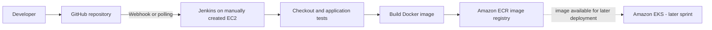
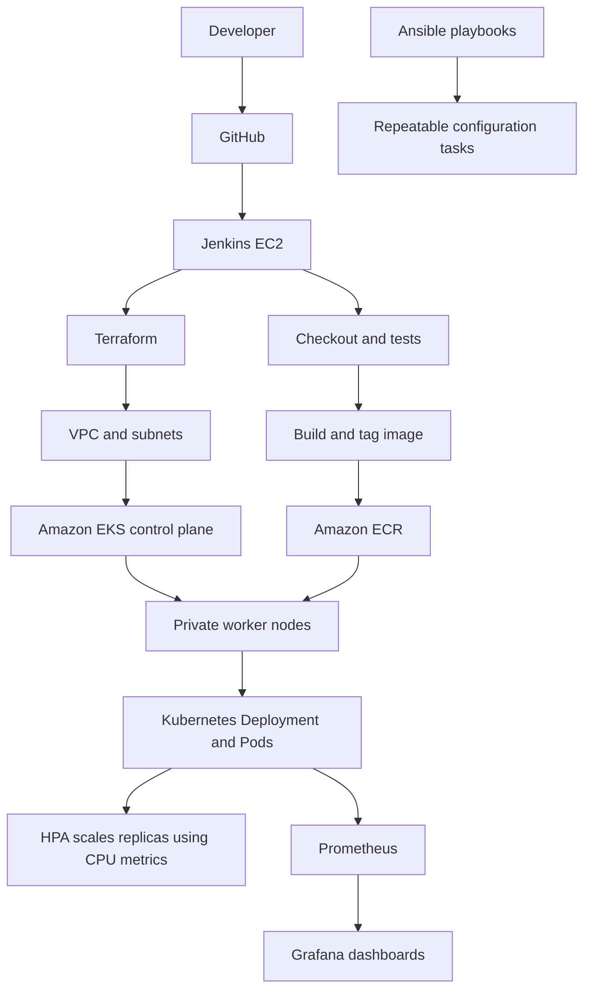

# End-to-End DevOps Pipeline for a Web Application

A capstone project demonstrating CI/CD, Infrastructure as Code, containerization, Kubernetes deployment, configuration management, autoscaling, and monitoring.

**Repository:** https://github.com/mouleeswarand/devops-capstone-project  
**AWS region:** `us-east-1`  
**Kubernetes cluster:** `devops-capstone-eks`  
**Application deployment:** `devops-capstone-app`  
**Terraform working directory (WSL):** `devops-capstone-project/terraform`  
**Kubernetes manifests (WSL):** `~devops-capstone-project/k8s`

## 1. Project goals

- Build and test application code with Jenkins.
- Build a Docker image and publish it to Amazon ECR.
- Deploy the image to Amazon EKS and verify rollout health.
- Use Terraform for repeatable AWS infrastructure.
- Use Ansible for repeatable configuration tasks.
- Use Kubernetes resource requests/limits and Horizontal Pod Autoscaler (HPA).
- Collect metrics with Prometheus and visualize them in Grafana.
- Capture command output and screenshots as evidence for each sprint.

## 2. Sprint plan

| Sprint | Delivery | Automation level |
|---|---|---|
| Sprint 1 | Manually create/configure Jenkins EC2, install Jenkins and required tools, connect source control, create the initial pipeline | Manual foundation |
| Sprint 2 | Complete continuous integration and image delivery: checkout, tests, Docker build, ECR login/push; confirm the pipeline runs successfully | CI established; Jenkins EC2 remains manually provisioned |
| Sprint 3 | Terraform-managed AWS foundation and EKS resources; validate infrastructure state and cluster access | Infrastructure as Code |
| Sprint 4 | Kubernetes deployment and CI/CD release to EKS; verify pods, services, rollout and HPA | Automated deployment |
| Sprint 5 | Ansible configuration/provisioning tasks and repeatable operational steps | Configuration management |
| Sprint 6 | Prometheus/Grafana monitoring, metric queries, load/HPA validation, final evidence and documentation | Monitoring and final validation |

The sprint names above describe the project flow. Update them if the submitted course rubric uses different official titles.

## 3. Architecture

### Sprints 1–2: manual Jenkins foundation and CI



**Flow:** A code change reaches GitHub. Jenkins checks out the code, runs tests, builds the container image and pushes a versioned image to ECR. In these sprints, Jenkins EC2 provisioning is manual; the CI pipeline is configured and validated through Jenkins.

### Sprints 3–6: infrastructure, deployment, configuration and monitoring



**Design note:** Terraform creates/updates infrastructure; Jenkins orchestrates build and release; ECR stores container images; EKS runs the workload; Ansible handles the configuration tasks defined in the repository; Prometheus collects metrics and Grafana displays them. Keep the actual deployment and monitoring paths consistent with the files in the repository.

## 4. Prerequisites

- AWS account permissions for the Terraform resources used by this project.
- AWS CLI configured for the intended account and `us-east-1`.
- Terraform, `kubectl`, and (where applicable) Ansible installed on the machine running the commands.
- Docker available to the Jenkins build environment.
- Jenkins credentials for GitHub and AWS/ECR configured through Jenkins Credentials, not hard-coded in a Jenkinsfile.
- Access to the EKS cluster for `kubectl`.
- The project repository cloned locally.

Check the active AWS identity and tool versions before making changes:

```bash
aws sts get-caller-identity
# Confirms which AWS account and IAM identity the CLI is using.

aws configure get region
# Shows the default AWS CLI region, if configured.

terraform version
# Confirms Terraform is installed.

kubectl version --client
# Confirms the kubectl client is installed.

git status --short
# Show
